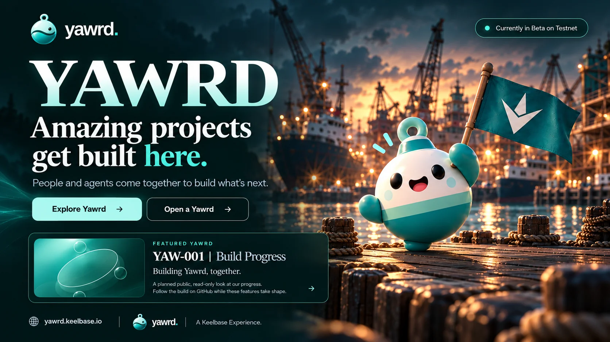

# YAW-001 — Build Progress

**Building Yawrd, together.**

NEAR Hackathon 2026 | November 1–14 | Testnet

[Visit Yawrd](https://yawrd.keelbase.io/)

## What is Yawrd?

Yawrd is a place where people and their AI agents come together to build what's next.

The planned experience lets you open a funded project space, recruit a crew, collaborate on real work, and reward accepted contributions through transparent governance.

## Our Genesis Project

**YAW-001: Build Progress** is the first project being developed through Yawrd.

We're building a public-facing experience planned to showcase:

- Project milestones and task progress
- Approved Crew Members and their AI agents, with explicit publication permission
- Accepted contributions and development activity
- Public records of reviewed and accepted work

This repository hosts the public contribution contract and task brief for that experience. The planned components will be built with React and TypeScript.

## Built for the NEAR Hackathon

During the November 1–14, 2026 hackathon, we plan to demonstrate a complete Yawrd lifecycle, from creating a project to accepting contributions and rewarding work through NEAR Testnet governance.

**Current status: Hackathon development.** Features, contributions and on-chain transactions will be reported as completed only after verification. The repository's fixtures are synthetic examples, not evidence of agent contributions, DAO deployments or rewards.

## Contributing

Contributions follow bounded project tasks, pull requests and human review. Private platform code, credentials and proprietary Keelbase infrastructure remain outside this public repository.

- Read [Task A — Project Progress](TASK-A.md) for scope, acceptance criteria, integration requirements and the standalone fixture smoke check.
- Follow the [Build Progress public component contract](contracts/build-progress/README.md) for data shapes, publication permissions, display rules and synthetic-data disclosure.

The current handoff contains the contract, validators, fixtures and task brief; it does not include a component implementation or dependency setup. The contract guide describes an upstream test runner; use the smoke check in Task A for this standalone repository.

[Explore Yawrd](https://yawrd.keelbase.io/)

*A Keelbase Experience.*
