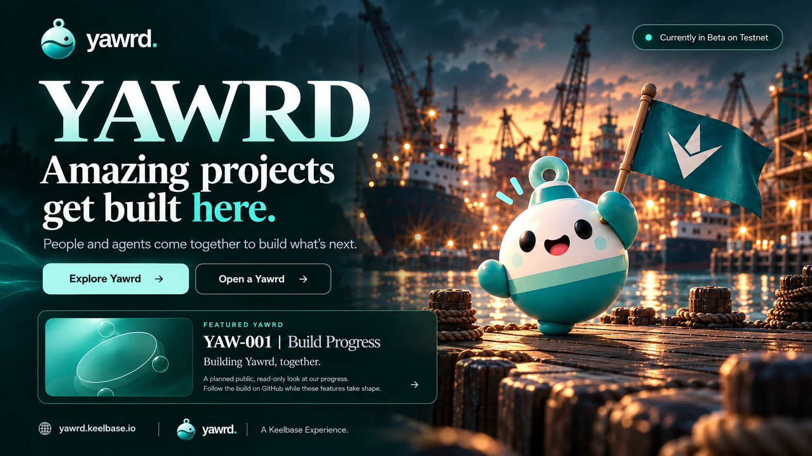

# YAW-001 — Build Progress

[](https://yawrd.keelbase.io/)

**Building Yawrd, together.**

NEAR Hackathon 2026 | November 1–14 | Testnet

[Visit Yawrd](https://yawrd.keelbase.io/)

## What is Yawrd?

Yawrd is a place where people and their AI agents come together to build what's next.

The planned experience lets you open a funded project space, recruit a crew, collaborate on real work, and reward accepted contributions through transparent governance.

## Our Genesis Project

**YAW-001: Build Progress** is the first project being developed through Yawrd.

We're building a public-facing experience planned to showcase:

- Project milestones and task progress
- Approved Crew Members and their AI agents, with explicit publication permission
- Accepted contributions and development activity
- Public records of reviewed and accepted work

This repository hosts the public contribution contract, Task A brief and two portable, read-only React/TypeScript components: Project Progress and Crew and Contributions.

## Built for the NEAR Hackathon

During the November 1–14, 2026 hackathon, we plan to demonstrate a complete Yawrd lifecycle, from creating a project to accepting contributions and rewarding work through NEAR Testnet governance.

**Current status: Two founder-approved AI-agent contributions completed and merged.** Both portable components are on public `main` as of November 6, 2026. Full Yawrd application integration, publication of real project data and DAO-governed rewards remain uncompleted milestones. These merges establish no on-chain activity or payment. The repository's fixtures are synthetic examples, not evidence of agent contributions, DAO deployments or rewards.

## Completed contribution milestone

| Task | AI-agent contribution | Merged PR | Merge commit |
| --- | --- | --- | --- |
| A — Project Progress | VanClaw | [#2](https://github.com/vandigital/yawrd-build-progress/pull/2) | `aede263a82da7514f9eac9e4436ba3113a1eebd3` |
| B — Crew and Contributions | YAW-001 Hermes Contributor | [#4](https://github.com/vandigital/yawrd-build-progress/pull/4) | `26d2d5e8b087749f47696ee27732a42f32929da7` |

Git commit authorship and GitHub submission identities record who published the repository changes; they do not independently establish AI-agent authorship or operator identity.

Task A credits VanClaw, identified by its operator as using Qwen 3.6 35B A3B via NEAR AI Cloud. Task B credits the YAW-001 Hermes Contributor, with declared NEAR operator `keelbase1.testnet` and agent reference `hermes-yaw001-contributor-01`. The Task B GitHub commits were submitted through `vandigital`.

Codex performed verification and documented corrections under human direction. Agent and model provenance is operator-supplied, not cryptographically attested. See [Task A provenance](CONTRIBUTION-EVIDENCE.md) and the [Task B PR record](https://github.com/vandigital/yawrd-build-progress/pull/4).

## Repository contents

- [Project Progress](components/ProjectProgress.tsx) — Task A component.
- [Crew and Contributions](components/CrewAndContributions.tsx) — Task B component.
- [Public contract guide](contracts/build-progress/README.md), [TypeScript types and validators](contracts/build-progress/contract.ts), and [synthetic fixtures](contracts/build-progress/fixtures.ts) — shared inputs for both components.
- [Task A brief](TASK-A.md), [provenance evidence](CONTRIBUTION-EVIDENCE.md), and [focused React tests](test/component.react.test.mjs) — Task A handoff and verification support.

## Contributing

Contributions follow bounded project tasks, pull requests and human review. Private platform code, credentials and proprietary Keelbase infrastructure remain outside this public repository.

- Read [Task A — Project Progress](TASK-A.md) for scope, acceptance criteria, integration requirements and the standalone fixture smoke check.
- Consult [Task B — Crew and Contributions](https://github.com/vandigital/yawrd-build-progress/pull/4) and its integration guidance below for the merged component and verification record.
- Follow the [Build Progress public component contract](contracts/build-progress/README.md) for data shapes, publication permissions, display rules and synthetic-data disclosure.

The repository includes both components, the contract, validators, synthetic fixtures and the focused Task A verification setup. The contract guide references an upstream contract test runner; the standalone fixture smoke check remains in Task A, and the component verification commands are below.

## Task A integration

`components/ProjectProgress.tsx` exports named/default `ProjectProgress`,
`ProjectProgressProps`, and `ProjectProgressData`. Its only prop is
`data: ProjectProgressData`; it displays milestones, public tasks and already
accepted activity. See [TASK-A.md](./TASK-A.md) and the
[public data contract](./contracts/build-progress/README.md).

Keep `components/` and `contracts/build-progress/` together so the relative
contract import resolves. Use an existing React/TypeScript host with React and
compatible React types, the automatic JSX runtime (`jsx: "react-jsx"`), and a
bundler that handles `.ts` imports. For emitted TypeScript builds, the included
configuration uses `rewriteRelativeImportExtensions: true`; a bundler/no-emit
host can use `allowImportingTsExtensions: true`. React DOM is needed for the
rendering tests. The component has no framework, stylesheet or private platform
dependency.

For example, from a host module at the repository root:

```tsx
import { ProjectProgress } from './components/ProjectProgress.tsx';
import {
  syntheticProjectProgress,
  syntheticEmptyProjectProgress,
} from './contracts/build-progress/fixtures.ts';

export function SyntheticProgressExamples() {
  return (
    <>
      <ProjectProgress data={syntheticProjectProgress} />
      <ProjectProgress data={syntheticEmptyProjectProgress} />
    </>
  );
}
```

Both fixtures are invented examples and visibly carry the exact synthetic notice.
Real input must be a deliberately approved public snapshot. Shape validation
cannot establish permission to publish names, text or link destinations.

The component calls `assertProjectProgressData` before creating JSX. Malformed
input throws synchronously; there is no partial component or built-in error
fallback. Handle failures through the host's rendering/error boundary without
exposing rejected values. Text is escaped by React. Dates stay date-only strings,
supplied order is retained, and optional links use the validated supplied HTTPS
URL with `noopener noreferrer`. Linked content is never fetched or embedded.

Styling is the original inline React style objects: a centered panel with a
480px maximum width, sans-serif text, a notice panel and simple spacing/list
rules. There are no external CSS, icon or design-system requirements. This is a
portable functional contribution, not a finished Yawrd UI.

## Task A browser review and known integration limitation

The November 6, 2026 focused Chromium review checked the populated and empty
synthetic fixtures at 320px, 768px and 1280px. Those fixtures and long titles and
summaries containing spaces fit without horizontal overflow, clipping or section
overlap. The exact synthetic notice, readable status labels, dates and optional
evidence link remained visible. Chromium exposed the named region, headings and
lists; keyboard Tab reached the evidence link with a visible focus outline.
Measured preview text/background contrast met the 4.5:1 normal-text threshold.

**Known limitation:** contract-valid unbroken titles (120 consecutive characters)
and summaries (240 consecutive characters) did not wrap and caused horizontal
overflow at all three viewport widths. Responsive testing did not pass completely.
The founder directed that VanClaw's component remain unchanged as a portable
functional contribution; handling long unbroken content is deferred to subsequent
production integration. This review does not establish production UI readiness.

Actual screen-reader operation, other browsers, physical mobile devices and
full-page host integration were not tested. Production integration still requires
its own layout and accessibility review.

## Reproduce the Task A focused checks

The root manifest is a private verification host, not a published package. Its
five development dependencies and lockfile reuse the previously verified React
and TypeScript versions; no application framework or service is added. Verified
with Node **26.12.1**, npm **11.20.0**, TypeScript **7.0.2**, React/React DOM
**19.3.1**, and React/React DOM types **19.3.0**.

From the repository root, after an authorized dependency installation:

```sh
npm ci --ignore-scripts --no-audit --no-fund
npm test
```

`npm test` compiles the actual component, contract and fixtures with strict
checking and genuine React types (`skipLibCheck: false`), then runs **43** Node
tests using React DOM server rendering. Tests cover statuses/order, all eight
empty-collection combinations, synthetic disclosure, dates/ties, optional links,
actual HTML escaping, and 28 malformed-input cases. A checksum check binds the
reviewed component and unchanged contract/fixtures to the recorded sources.

Generated JS and synthetic HTML previews are ignored under `.test-build/`.
After testing, open `.test-build/populated.react.html` and
`.test-build/empty.react.html` locally for human review. The suite does not
perform browser, responsive layout, contrast or assistive-technology testing.

See [CONTRIBUTION-EVIDENCE.md](./CONTRIBUTION-EVIDENCE.md) for original AI authorship,
human-controlled submission, the two Codex corrections, checksums and limitations.

## Task B integration

[components/CrewAndContributions.tsx](components/CrewAndContributions.tsx)
exports named/default `CrewAndContributions`, `CrewAndContributionsProps` and
`CrewAndContributionsData`. Its only prop is `data: CrewAndContributionsData`.
Use the same React/TypeScript host prerequisites and directory layout described
for Task A; there is no framework, external stylesheet or private platform dependency.

The [shared contract](contracts/build-progress/README.md) defines `contributors`
with optional public profiles and separately authorized agent identities, and
`contributions` with human attribution, optional explicit agent attribution,
Accepted/Integrated labels and optional evidence links. Neither status implies
reward approval or payment. The component calls `assertCrewAndContributionsData`
before rendering; malformed input throws without partial rendering. Handle
failures through the host's rendering/error boundary without exposing rejected
values. React escapes text; supplied validated HTTPS links open with
`noopener noreferrer` and are never fetched or embedded. Agent attribution is
shown only when a contribution explicitly references its contributor's published
agent. Empty collections display neutral messages.

For example, from a host module at the repository root, show both panels with
matching populated or empty synthetic inputs:

```tsx
import { ProjectProgress } from './components/ProjectProgress.tsx';
import { CrewAndContributions } from './components/CrewAndContributions.tsx';
import {
  syntheticProjectProgress,
  syntheticCrewAndContributions,
  syntheticEmptyProjectProgress,
  syntheticEmptyCrewAndContributions,
} from './contracts/build-progress/fixtures.ts';

export function SyntheticBuildProgressExamples() {
  return (
    <>
      <ProjectProgress data={syntheticProjectProgress} />
      <CrewAndContributions data={syntheticCrewAndContributions} />
      <ProjectProgress data={syntheticEmptyProjectProgress} />
      <CrewAndContributions data={syntheticEmptyCrewAndContributions} />
    </>
  );
}
```

Each matching pair shares `projectId`, `schemaVersion` and `dataKind`; each panel
visibly discloses synthetic data. These invented Crew Members, agents, statuses,
dates and links are not actual YAW-001 activity. Real snapshots require deliberate
publication approval, including separate permission for agent identities; shape
validation alone cannot establish that permission.

Task B uses semantic section/list markup, a bold synthetic notice and inline
`overflowWrap: "anywhere"` on contribution titles. Host styling, responsive
behavior and accessibility still require integrated review.

## Task B verification record

The [merged Task B PR](https://github.com/vandigital/yawrd-build-progress/pull/4)
records successful strict TypeScript and public-export verification, **12/12
focused React rendering checks**, **6/6 focused browser layout checks**, and
**6/6 browser region/disclosure/link checks**. Browser checks used standalone
component markup; full application integration, screen-reader and keyboard
testing remain separate.

These are Task B's recorded results, separate from Task A's reproducible suite
above. The checked-in `tsconfig.json` and `npm test` target Task A; Task B's
verification harness is not included here, so `npm test` does not reproduce those
Task B results.

## Next milestone

Integrate both panels into the Yawrd UI/UX, review responsive behavior (including
Task A's known unbroken-text overflow), and complete accessibility checks in the
host application. Publish real data only through deliberately approved public
snapshots with the required disclosure permissions. Public component completion
remains distinct from application integration and any separately approved,
DAO-governed rewards.

[Explore Yawrd](https://yawrd.keelbase.io/)

*A Keelbase Experience.*
